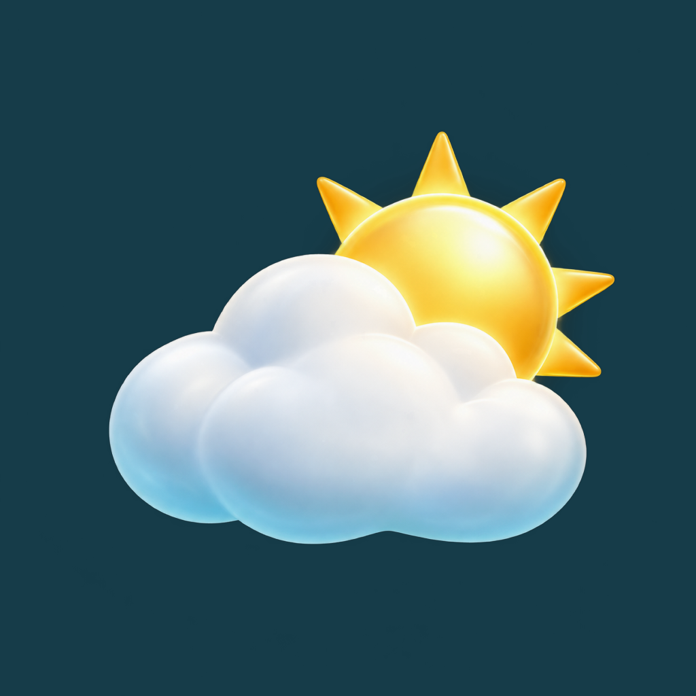

<p align="center">
  
</p>

<h1 align="center">Atmos</h1>
<p align="center">Погода и подсказка, что надеть — на ближайший час или весь день.</p>
<p align="center">
  <a href="https://v-kozintsev.github.io/atmos-weather/">Открыть приложение</a> ·
  <a href="https://www.rustore.ru/catalog/app/ru.puskweb.atmos">Android</a> ·
  <a href="https://github.com/V-Kozintsev/atmos-weather/releases/latest">Windows</a>
</p>

## Что умеет

- Показывает текущую погоду, почасовой прогноз и неделю вперёд.
- Подбирает мужские и женские образы с учётом температуры, ветра и осадков.
- Учитывает стиль и чувствительность к холоду; помогает подготовиться к вечеру.
- Находит города, сохраняет избранное и последний прогноз на случай сбоя сети.
- Открывает поиск похожих вещей на Ozon и Wildberries.

Без обязательной регистрации. Настройки остаются на устройстве. Фото образов — примеры утепления; точный комплект указан в списке вещей. Ссылки на магазины пока обычные, без комиссии.

## Где пользоваться

| Версия | Возможности |
| :--- | :--- |
| **[Android](https://www.rustore.ru/catalog/app/ru.puskweb.atmos)** | React Native / Expo: компактный интерфейс, виджет, увеличение фото и атмосферные фоны. Обновление 3.0 на модерации; в магазине доступна 2.2.1. |
| **[Веб](https://v-kozintsev.github.io/atmos-weather/)** | Адаптивная погодная панель, графики и установка на главный экран через браузер. |
| **[Windows](https://github.com/V-Kozintsev/atmos-weather/releases/latest)** | Electron: мини-погода поверх окон, область уведомлений и обновления установщика. |

iOS-приложение пока не опубликовано. На iPhone веб-версию можно добавить через Safari → «Поделиться» → «На экран Домой».

## Быстрый запуск

Нужен Node.js 22.18+ или 24+. Ключ погодного API и отдельный сервер не требуются.

```sh
npm ci
npm run dev
```

Веб-версия откроется на `http://127.0.0.1:9000`.

Для мобильного интерфейса:

```sh
npm --prefix mobile ci
npm run native:dev
```

Локальный просмотр: `http://127.0.0.1:9002`. Android-эмулятор или телефон: `npm run native:android` — нужны Android Studio, Android SDK и совместимый JDK.

## Стек

**React · React Native · Expo · TypeScript · Vite · Electron · PWA · SVG**

Общая логика прогноза и подбора одежды находится в `src/lib`, мобильный интерфейс — в `mobile`.

<details>
<summary><strong>Сборка и проверки</strong></summary>

- Веб: `npm run build`; просмотр сборки: `npm run preview`.
- Проверки: `npm test`, `npm run typecheck`, `npm run native:typecheck`.
- Windows: `npm run desktop`; установщик и portable: `npm run desktop:build`.
- Android: `npm --prefix mobile run prebuild:android`, затем `npm --prefix mobile run build:android`.
- iOS: `npm --prefix mobile run ios` на Mac с Xcode.

Android-релиз использует пакет `ru.puskweb.atmos` и прежний ключ подписи. Параметры `ATMOS_KEYSTORE`, `ATMOS_STORE_PASSWORD`, `ATMOS_KEY_ALIAS`, `ATMOS_KEY_PASSWORD` передаются через окружение. Ключи и пароли не входят в репозиторий. Тестовый пакет — `ru.puskweb.atmos.dev`.

Старые проекты Capacitor сохранены для совместимости. `npm run mobile:sync` обновляет их веб-ресурсы, но не собирает React Native. Веб публикуется через GitHub Actions при обновлении `main`; Windows-сборки — через теги `v*`.

</details>

<details>
<summary><strong>Установка и диагностика</strong></summary>

В Chrome / Edge установите веб-версию через меню браузера. После первого запуска интерфейс доступен без сети; сохранённый прогноз используется до суток и отмечается как сохранённый. Свежим данным нужен интернет.

Windows 10/11, 64 бит: [установщик](https://github.com/V-Kozintsev/atmos-weather/releases/latest/download/Atmos-Setup-x64.exe) или [portable](https://github.com/V-Kozintsev/atmos-weather/releases/latest/download/Atmos-Portable-x64.exe). Закрытие окна сворачивает приложение в область уведомлений. Установщик проверяет обновления; portable заменяется вручную. Сборка без цифровой подписи. [Мини-панель в браузере](https://v-kozintsev.github.io/atmos-weather/?view=mini) не закрепляется поверх окон.

Диагностика веба: `localStorage.setItem('atmos-debug', 'true')`, отключение — `localStorage.removeItem('atmos-debug')`. Префикс `[Atmos API]`; координаты и поисковые запросы не выводятся. Windows: `Atmos.exe --diagnostics`; фоновый запуск — `--background`. В Electron отключён доступ интерфейса к Node.js, внешние HTTPS-ссылки открываются в браузере.

</details>

## Данные и приватность

Прогноз — [MET Norway](https://api.met.no/doc/License), города — [GeoNames](https://www.geonames.org/export/) (CC BY). Геолокация запрашивается по нажатию, координаты округляются до 0,01°. Мобильные фоны — локальные снимки и Wikimedia Commons с указанием авторства; фон можно отключить. [Политика конфиденциальности](https://v-kozintsev.github.io/atmos-weather/privacy.html).

Проект вырос из учебной работы OTUS. [Сертификат](./сертификат.pdf); первоначальная версия сохранена в истории Git.

Разработчик — **[PuskWeb](https://puskweb.ru/)**. Для сообщения об ошибке [создайте issue](https://github.com/V-Kozintsev/atmos-weather/issues).
